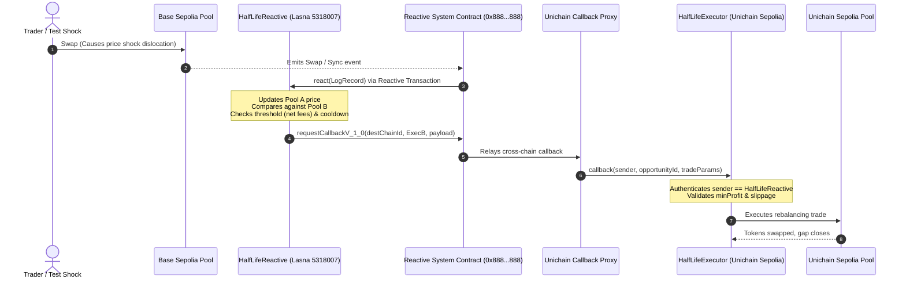

# Halfway Specification

**Status:** Draft (Phase 0 complete, pending Gate A approval)  
**Track:** Reactive Omni Buildathon — Every Second Counts  
**Deadline:** December 5, 2026  

---

## 1. Executive Summary & Product Vision

**Halfway** is a non-custodial cross-chain price-gap capture vault built on **Reactive Network Omni**. It continuously monitors price dislocation across equivalent liquidity pools on **Base Sepolia** and **Unichain Sepolia**. When the price spread between the two chains exceeds a user-configured threshold net of fees, a reactive smart contract deployed on Reactive Lasna automatically requests execution callbacks on both chains to trade against the pools, closing the gap.

### The Name Logic
When a price dislocation occurs, arbitrageurs act to eliminate it. The gap halves, and halves again, following exponential decay. Halfway is the precision instrument that measures how fast this decay occurs and captures it before legacy market makers can react.

### The Signature Feature: Latency Lab
The **Latency Lab** calculates real on-chain reaction times across every hop of the execution loop:
1. **Hop 1 ($T_0$):** Origin swap inclusion on Chain A.
2. **Hop 2 ($T_1$):** Reactive reaction transaction on Reactive Lasna.
3. **Hop 3 ($T_2$):** Callback execution on Chain B (closing the gap).
4. **Hop 4 ($T_3$):** Gap-closed confirmation.

The system calculates empirical **Gap Half-Life ($\tau_{1/2}$)** and demonstrates counterfactual loss: how much opportunity slower, legacy infrastructure (~7s latency) would forfeit compared to Omni (~1s instant finality).

---

## 2. Architecture & System Flow



---

## 3. Smart Contract Specifications

### 3.1 `HalfLifeReactive.sol` (Reactive Lasna - Chain ID `5318007`)
- **Inheritance:** `AbstractReactive` (from `@reactive-lib-omni`).
- **Core Responsibilities:**
  - Maintains subscriptions via `SYSTEM.subscribe(...)` for target pools on Base Sepolia (`84532`) and Unichain Sepolia (`1301`).
  - Stores cached price state, last update timestamps, and running ticks/reserves for each pool.
  - Implements `react(LogRecord calldata log_) external onlySystem`.
  - Calculates spread:
    $$\Delta P_{bps} = \left| \frac{P_A - P_B}{\min(P_A, P_B)} \right| \times 10,000$$
  - Compares $\Delta P_{bps}$ against user strategy threshold $+$ pool fees $+$ gas compensation margin.
  - Checks timestamp-based cooldown to avoid double-triggering on consecutive blocks.
  - Requests callback execution via `SYSTEM.requestCallbackV_1_0(config)`.

### 3.2 `HalfLifeExecutor.sol` (Base Sepolia & Unichain Sepolia)
- **Inheritance:** `AbstractCallback`, `Ownable2Step`, `ReentrancyGuard`.
- **Core Responsibilities:**
  - Non-custodial user deposits and withdrawals (`deposit()`, `withdraw()`).
  - Callback entrypoint:
    ```solidity
    function executeArbitrage(
        address callbackSender,
        bytes32 opportunityId,
        address pool,
        bool zeroForOne,
        uint256 amountIn,
        uint256 minAmountOut,
        uint256 deadline
    ) external onlyCallbackSender(callbackSender) nonReentrant;
    ```
  - Slippage and min-profit verification: Reverts if price moved unfavorably between reaction and callback execution.
  - Rich events emitting `opportunityId`, `amountIn`, `amountOut`, `profit`, and timestamp for the indexer.

---

## 4. Latency Lab & Measurement Engine

### 4.1 Honest Metric Definitions
Our liquidity pools are dedicated testnet pools with no external competing arbitrageurs. Consequently, a price dislocation does **not** naturally decay by itself. We explicitly do **not** claim an organic "natural gap half-life". Instead, all latency metrics are split into strictly **MEASURED** on-chain/observer hops and a clearly labeled **SIMULATED** competitive latency budget model.

### 4.2 Measured Hops Anatomy
- **$T_0$ (Origin Swap Inclusion):** Block timestamp of the shock swap event included on origin chain (Base Sepolia or Unichain Sepolia).
- **$T_1$ (Reactive Processing):** Block timestamp of the reactive transaction executing `react()` on Reactive Lasna (Chain ID `5318007`).
- **$T_2$ (Callback Execution):** Block timestamp of the callback transaction calling `executeCallback()` on destination chain.
- **$T_3$ (Gap Closed):** The first moment the normalized cross-chain price gap falls to or below the strategy threshold ($G \le \text{threshold}$), calculated directly from pool reserves after the last leg completes.

### 4.3 Measured Closure Metrics
- **Half-Closure Time ($T_{1/2}$ - Measured):** Real elapsed time from shock swap inclusion ($T_0$) until the normalized price gap first falls to 50% of its initial post-shock magnitude ($G(t) \le 0.5 \cdot G_0$).
- **Total Closure Time ($T_{\text{close}}$ - Measured):** Real elapsed time from $T_0$ until the gap is at or below threshold ($G(t) \le \text{threshold}$).
- Both metrics are calculated strictly from verifiable on-chain `Sync`/`Swap` events and consensus block timestamps, accompanied by local observer wall-clock timestamps.

### 4.4 Competitive Latency Budget Model (SIMULATED)
The Latency Budget is a clearly labeled **mathematical simulation model**, not a physical measurement:
- **Model Formulation:** Given an assumed competitor reaction half-life $h$ (user-configurable assumption, defaulted to an explicit baseline, e.g., $h = 5.0\text{s}$):
  $$\text{Remaining Opportunity Share} = \left(\frac{1}{2}\right)^{\frac{L}{h}}$$
  $$\text{Opportunity Captured} = \text{Initial Gap} \cdot \left(\frac{1}{2}\right)^{\frac{L}{h}}$$
- **Presets Available:**
  - $L = \text{Measured } p50$ (from live on-chain runs)
  - $L = 7.0\text{s}$ (Legacy relayer/polling baseline, documented figure, not measured)
  - $L = \text{Custom user input}$
- **User Presentation:** "At $h = X\text{s}$ (assumed competitor half-life), our loop of $Y\text{s}$ captures $Z\%$ of the theoretical maximum." Every presentation must clearly bear the `[SIMULATION MODEL]` label.

### 4.5 Headline Statistics & Filtering Rules
- Only **COMPLETE** loops ($T_0 \to T_1 \to T_2 \to T_3$) are included in aggregate headline metrics (p50, p90, max).
- Incomplete, skipped, or failed executions are logged with explicit reason codes (`DEADLINE_EXPIRED`, `SLIPPAGE_EXCEEDED`, `BELOW_HURDLE`, `RELAYER_PENDING`) and excluded from headline latency distributions.
- Every report details sample size $N$, active date range, and exclusions breakdown.
- Dual-source timestamps: Every record explicitly labels whether a timestamp originates from consensus block headers (`blockTime`) or the synchronized daemon observer (`observedAt`).

---

## 5. Indexer & API Architecture

### 5.1 Architecture Decision: viem + SQLite vs Ponder
We evaluated Ponder versus a dedicated TypeScript service with `viem` and `better-sqlite3`:
- **Justification for `viem` + SQLite:**
  1. **CometBFT RPC Compatibility:** Reactive Lasna operates a custom CometBFT consensus engine where `eth_getLogs` and block event structures require specialized polling intervals and log filter semantics that fail in Ponder's standard EVM multi-chain pipeline.
  2. **Three-Chain Dynamic Correlation:** The indexer must correlate events across Base Sepolia, Unichain Sepolia, and Reactive Lasna in real time, joining them by deterministic `opportunityId`.
  3. **RPC Rate-Limit Protection:** Custom viem clients allow granular backoff, caching, and automatic fallback from Alchemy to public RPCs without tripping free-tier rate limits.
  4. **Portability:** `better-sqlite3` provides fast, file-based ACID storage for development and local testing, while remaining 100% schema-compatible with Postgres for production deployment.

### 5.2 Indexed Entities & Schema
- **`pools`:** Contract address, chain ID, token0, token1, reserve0, reserve1, price, last block, last updated timestamp.
- **`opportunities`:** Unique `opportunityId`, origin chain, destination chain, origin tx, lasna tx, dest tx, $T_0, T_1, T_2, T_3$, raw spread bps, captured spread, status (`detected`, `executed`, `skipped`, `failed`), leg amounts, realized PnL.
- **`vault_snapshots`:** Executor address, chain ID, total shares, reserve0, reserve1, paused status, consecutive failures, timestamp.
- **`system_health`:** Lasna contract lREACT balance, RPC latency per chain, observer clock drift offset.

---

## 6. Frontend Specifications ("Isotope Lab")

- **Framework:** Next.js (App Router), strict TypeScript, wagmi, viem, TanStack Query, Tailwind CSS tokens.
- **Aesthetic:** Field notebook / precision nuclear lab instrument.
  - Light mode: Bone `#EFEAE0`, Deep Ink `#15130F`, Graphite `#5B5750`.
  - Dark mode: Warm Charcoal `#14110E`, Bone `#EFEAE0`.
  - Signals: Signal Vermilion `#FF4B1F` (Dislocation/Shock), Reaction Lime `#C9F23A` (Captured/Profit).
- **Core Views:**
  1. **Decay Scope:** Real-time oscilloscope canvas showing live gap bps and fitted half-life curve.
  2. **Loop Anatomy Waterfall:** Ticker-tape breakdown of all 4 hops with transaction links.
  3. **Isotope Pool Tiles:** Periodic-table tiles showing chain atomic numbers and pool metrics.
  4. **Delay Slider (SIMULATED):** Interactive counterfactual slider showing profit decay under legacy 7s latencies.
  5. **Fire Test Shock Tool:** One-click swap triggering real on-chain price dislocation to test the live loop.
