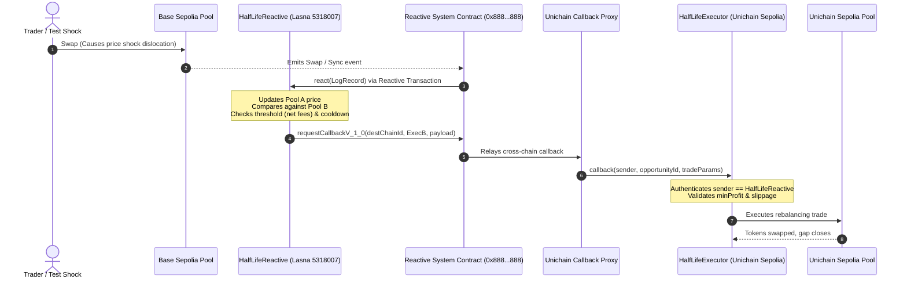

# Halfway Specification

**Status:** Draft (Phase 0 complete, pending Gate A approval)  
**Track:** Reactive Omni Buildathon — Every Second Counts  
**Deadline:** December 5, 2026  

---

## 1. Executive Summary & Product Vision

**Halfway** is a non-custodial cross-chain price-gap capture vault built on **Reactive Network Omni**. It continuously monitors price dislocation across equivalent liquidity pools on **Base Sepolia** and **Unichain Sepolia**. When the price spread between the two chains exceeds a user-configured threshold net of fees, a reactive smart contract deployed on Reactive Lasna automatically requests execution callbacks on both chains to trade against the pools, closing the gap.

### The Name Logic
When a price dislocation occurs, arbitrageurs act to eliminate it. The gap halves, and halves again, following exponential decay. Halfway is the precision instrument that measures how fast this decay occurs and captures it before legacy market makers can react.

### The Signature Feature: Latency Lab
The **Latency Lab** calculates real on-chain reaction times across every hop of the execution loop:
1. **Hop 1 ($T_0$):** Origin swap inclusion on Chain A.
2. **Hop 2 ($T_1$):** Reactive reaction transaction on Reactive Lasna.
3. **Hop 3 ($T_2$):** Callback execution on Chain B (closing the gap).
4. **Hop 4 ($T_3$):** Gap-closed confirmation.

The system calculates empirical **Gap Half-Life ($\tau_{1/2}$)** and demonstrates counterfactual loss: how much opportunity slower, legacy infrastructure (~7s latency) would forfeit compared to Omni (~1s instant finality).

---

## 2. Architecture & System Flow



---

## 3. Smart Contract Specifications

### 3.1 `HalfLifeReactive.sol` (Reactive Lasna - Chain ID `5318007`)
- **Inheritance:** `AbstractReactive` (from `@reactive-lib-omni`).
- **Core Responsibilities:**
  - Maintains subscriptions via `SYSTEM.subscribe(...)` for target pools on Base Sepolia (`84532`) and Unichain Sepolia (`1301`).
  - Stores cached price state, last update timestamps, and running ticks/reserves for each pool.
  - Implements `react(LogRecord calldata log_) external onlySystem`.
  - Calculates spread:
    $$\Delta P_{bps} = \left| \frac{P_A - P_B}{\min(P_A, P_B)} \right| \times 10,000$$
  - Compares $\Delta P_{bps}$ against user strategy threshold $+$ pool fees $+$ gas compensation margin.
  - Checks timestamp-based cooldown to avoid double-triggering on consecutive blocks.
  - Requests callback execution via `SYSTEM.requestCallbackV_1_0(config)`.

### 3.2 `HalfLifeExecutor.sol` (Base Sepolia & Unichain Sepolia)
- **Inheritance:** `AbstractCallback`, `Ownable2Step`, `ReentrancyGuard`.
- **Core Responsibilities:**
  - Non-custodial user deposits and withdrawals (`deposit()`, `withdraw()`).
  - Callback entrypoint:
    ```solidity
    function executeArbitrage(
        address callbackSender,
        bytes32 opportunityId,
        address pool,
        bool zeroForOne,
        uint256 amountIn,
        uint256 minAmountOut,
        uint256 deadline
    ) external onlyCallbackSender(callbackSender) nonReentrant;
    ```
  - Slippage and min-profit verification: Reverts if price moved unfavorably between reaction and callback execution.
  - Rich events emitting `opportunityId`, `amountIn`, `amountOut`, `profit`, and timestamp for the indexer.

---

## 4. Latency Lab & Measurement Engine

### 4.1 Four-Hop Anatomy
- **$T_0$ (Origin Swap):** Event block timestamp on origin chain.
- **$T_1$ (Reactive Processing):** Block timestamp of `react()` on Lasna.
- **$T_2$ (Callback Execution):** Block timestamp of callback execution on destination chain.
- **$T_3$ (Gap Closed):** Timestamp of pool convergence verification.

### 4.2 Dual-Source Time Reporting
- **On-chain Header Timestamps:** Provable, consensus-stamped EVM block timestamps.
- **Off-chain Observer Timestamps:** High-resolution wall-clock timestamps recorded by the local daemon indexer.

### 4.3 Gap Half-Life Formula
Given initial dislocation $\Delta P_0$ and subsequent observations $\Delta P(t)$, the half-life $\tau_{1/2}$ is computed as:
$$\Delta P(t) = \Delta P_0 \cdot e^{-\lambda t} \implies \tau_{1/2} = \frac{\ln(2)}{\lambda}$$

---

## 5. Indexer & API Architecture

- **Stack:** Lightweight, high-throughput TypeScript indexer backed by SQLite.
- **RPC Hygiene:** Sane polling (2s intervals on L2s, 1s on Lasna), fallback public RPCs, exponential backoff to protect Alchemy free-tier quotas.
- **Data Models:**
  - `Opportunity`: `id`, `originChainId`, `destChainId`, `initialGapBps`, `status`, `t0`, `t1`, `t2`, `t3`, `reactionLatencyMs`.
  - `ExecutionLeg`: `opportunityId`, `chainId`, `txHash`, `pool`, `tokenIn`, `tokenOut`, `amountIn`, `amountOut`, `gasSpent`.

---

## 6. Frontend Specifications ("Isotope Lab")

- **Framework:** Next.js (App Router), strict TypeScript, wagmi, viem, TanStack Query, Tailwind CSS tokens.
- **Aesthetic:** Field notebook / precision nuclear lab instrument.
  - Light mode: Bone `#EFEAE0`, Deep Ink `#15130F`, Graphite `#5B5750`.
  - Dark mode: Warm Charcoal `#14110E`, Bone `#EFEAE0`.
  - Signals: Signal Vermilion `#FF4B1F` (Dislocation/Shock), Reaction Lime `#C9F23A` (Captured/Profit).
- **Core Views:**
  1. **Decay Scope:** Real-time oscilloscope canvas showing live gap bps and fitted half-life curve.
  2. **Loop Anatomy Waterfall:** Ticker-tape breakdown of all 4 hops with transaction links.
  3. **Isotope Pool Tiles:** Periodic-table tiles showing chain atomic numbers and pool metrics.
  4. **Delay Slider (SIMULATED):** Interactive counterfactual slider showing profit decay under legacy 7s latencies.
  5. **Fire Test Shock Tool:** One-click swap triggering real on-chain price dislocation to test the live loop.
